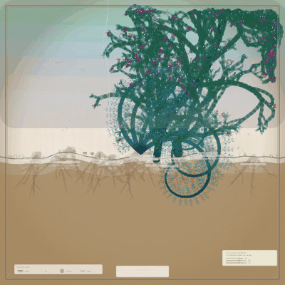
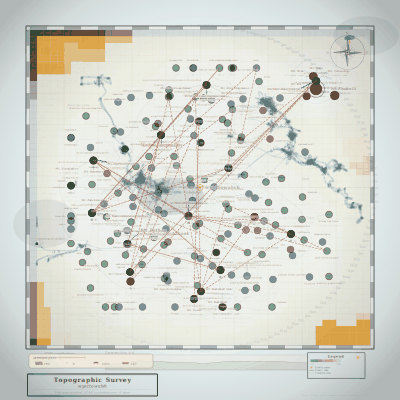
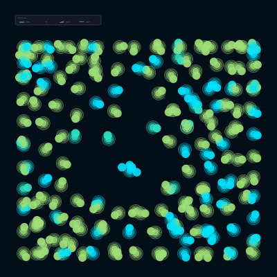
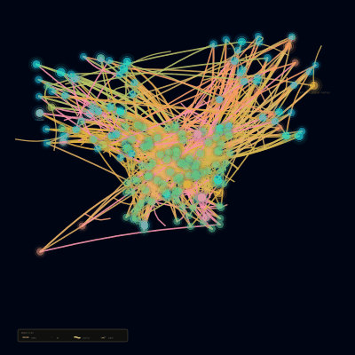
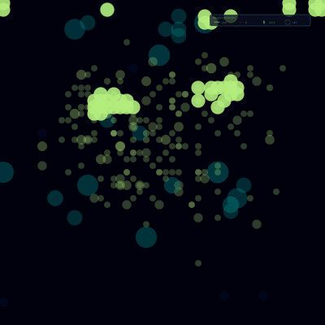
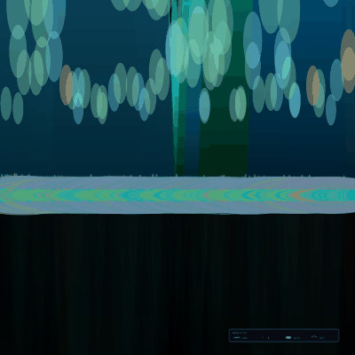

# Living Art

[Back to Wyatt’s profile](README.md#wyatt-walsh)

Six timelapses trace my GitHub history. Each frame shows the account up to one sampled day. A new repository can take root as a tree in one film and rise as a hill in another.

[Ink Garden](#ink-garden) · [Topography](#topography) · [Genetic Landscape](#genetic-landscape) · [Physarum](#physarum) · [Lenia](#lenia) · [Ferrofluid](#ferrofluid)

## Ink Garden

Each repository takes root as a tree, stem and canopy together. A day with no repos is bare soil.

Show or hide the Ink Garden preview

<a href=".github/assets/img/living-inkgarden.mp4"><picture>
  <source media="(prefers-reduced-motion: no-preference)" srcset=".github/assets/img/living-inkgarden.gif">
  
</picture></a>

[Watch Ink Garden (MP4)](.github/assets/img/living-inkgarden.mp4) · [Open GIF](.github/assets/img/living-inkgarden.gif)

Read the garden

- **Repos:** plants — one tree per repository, stem and canopy
- **Stars:** bloom — flowers on the trees
- **Commits:** trunk — thicker, taller boles
- **Followers:** glints among the leaves (none at zero followers)

## Topography

A hand-drawn survey of this account, with one hill for every repository. The map fills in as the years accrue.

Show or hide the Topography preview

<a href=".github/assets/img/living-topo.mp4"><picture>
  <source media="(prefers-reduced-motion: no-preference)" srcset=".github/assets/img/living-topo.gif">
  
</picture></a>

[Watch Topography (MP4)](.github/assets/img/living-topo.mp4) · [Open GIF](.github/assets/img/living-topo.gif)

Read the map

- **Repos:** peaks — one hill per repository
- **Stars:** prominence — how tall each summit stands
- **Commits:** contours — the lines that mark each hill
- **Followers:** settlements on the map

## Genetic Landscape

A landscape of competing fitness peaks, one ridge per repository. Life gathers on the high ground as the account evolves.

Show or hide the Genetic Landscape preview

<a href=".github/assets/img/living-genetic.mp4"><picture>
  <source media="(prefers-reduced-motion: no-preference)" srcset=".github/assets/img/living-genetic.gif">
  
</picture></a>

[Watch Genetic Landscape (MP4)](.github/assets/img/living-genetic.mp4) · [Open GIF](.github/assets/img/living-genetic.gif)

Read the landscape

- **Repos:** fitness peaks — one peak per repository
- **Stars:** peak height — how tall each summit stands
- **Commits:** generations stacked across the landscape
- **Followers:** colonies (none at zero followers)

## Physarum

A slime mold feeding in the dark, spinning a living network from the first repository. The organism is the veins, not a lone spore.

Show or hide the Physarum preview

<a href=".github/assets/img/living-physarum.mp4"><picture>
  <source media="(prefers-reduced-motion: no-preference)" srcset=".github/assets/img/living-physarum.gif">
  
</picture></a>

[Watch Physarum (MP4)](.github/assets/img/living-physarum.mp4) · [Open GIF](.github/assets/img/living-physarum.gif)

Read the vein network

- **Repos:** nutrient nodes — a network grown from the first repository
- **Stars:** how rich each food node is
- **Commits:** trail and vein growth
- **Followers:** vein mass (not the spore)

## Lenia

A continuous living field, seeded with one creature for every repository. Soft bodies pulse and wander as the account grows.

Show or hide the Lenia preview

<a href=".github/assets/img/living-lenia.mp4"><picture>
  <source media="(prefers-reduced-motion: no-preference)" srcset=".github/assets/img/living-lenia.gif">
  
</picture></a>

[Watch Lenia (MP4)](.github/assets/img/living-lenia.mp4) · [Open GIF](.github/assets/img/living-lenia.gif)

Read the living field

- **Repos:** seed organisms — one body per repository
- **Stars:** halo — the glow around each creature
- **Commits:** field occupancy — how much of the medium is alive
- **Followers:** spatial extent — how far the field spreads

## Ferrofluid

Black magnetic fluid standing in towers, one column for every repository. The pool bristles, ripples, and holds a field of its own.

Show or hide the Ferrofluid preview

<a href=".github/assets/img/living-ferrofluid.mp4"><picture>
  <source media="(prefers-reduced-motion: no-preference)" srcset=".github/assets/img/living-ferrofluid.gif">
  
</picture></a>

[Watch Ferrofluid (MP4)](.github/assets/img/living-ferrofluid.mp4) · [Open GIF](.github/assets/img/living-ferrofluid.gif)

Read the magnetic field

- **Repos:** dipoles — one tower per repository
- **Stars:** spike height — how far the fluid leaps
- **Commits:** ripples in the pool
- **Followers:** magnetic field around the towers

[Back to the gallery index](#living-art) · [Back to Wyatt’s profile](README.md#wyatt-walsh)
