

  <picture>
    <source media="(prefers-color-scheme: dark)" srcset=".github/assets/img/banner-dark.svg">
    
  </picture>

# Wyatt Walsh

I build open-source tools for exploring NBA data, working with AI agents, and designing light scenes on iPhone.

<!-- README:TOP_BADGES:START -->

  
  
  
  

<!-- README:TOP_BADGES:END -->

[Projects](#featured-projects)&nbsp;· [Metrics](#metrics)&nbsp;· [Skills](#my-tech-stack)&nbsp;· [Word&nbsp;clouds](#word-clouds)&nbsp;· [Writing](#latest-blog-posts)&nbsp;· [Living&nbsp;art&nbsp;gallery](LIVING_ART.md)&nbsp;· [Connect](#connect)

## Featured Projects

<!-- README:FEATURED_PROJECTS:START -->

Find a project by topic

- **Data &amp; developer tools** — [nbadb](https://github.com/wyattowalsh/nbadb) · [nbops](https://github.com/wyattowalsh/nbops) · [proxywhirl](https://github.com/wyattowalsh/proxywhirl) · [riso](https://github.com/wyattowalsh/riso)
- **AI &amp; automation** — [agentic-cad](https://github.com/wyattowalsh/agentic-cad) · [agents](https://github.com/wyattowalsh/agents) · [ai-web-feeds](https://github.com/wyattowalsh/ai-web-feeds) · [cwa](https://github.com/wyattowalsh/cwa) · [mcp-crawl4ai](https://github.com/wyattowalsh/mcp-crawl4ai) · [prompts](https://github.com/wyattowalsh/prompts)
- **Websites, maps &amp; publishing** — [copy-to-gmail](https://github.com/wyattowalsh/copy-to-gmail) · [NYC-recs](https://github.com/wyattowalsh/NYC-recs) · [personal-website](https://github.com/wyattowalsh/personal-website) · [profile-bits](https://github.com/wyattowalsh/profile-bits) · [wild-web-wrap-up](https://github.com/wyattowalsh/wild-web-wrap-up)
- **Jobs &amp; profiles** — [linkedin-profile-exporter](https://github.com/wyattowalsh/linkedin-profile-exporter) · [openopps](https://github.com/wyattowalsh/openopps)
- **Media, music &amp; lighting** — [awesome-iina](https://github.com/wyattowalsh/awesome-iina) · [fl-mcp](https://github.com/wyattowalsh/fl-mcp) · [hue-board](https://github.com/wyattowalsh/hue-board) · [iina-plugin-bookmarks](https://github.com/wyattowalsh/iina-plugin-bookmarks) · [iina-plugin-starter](https://github.com/wyattowalsh/iina-plugin-starter) · [soundlab](https://github.com/wyattowalsh/soundlab) · [webmedia-dl](https://github.com/wyattowalsh/webmedia-dl)

<a href="https://github.com/wyattowalsh/nbadb">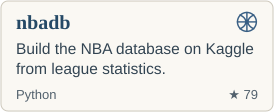</a>
<a href="https://github.com/wyattowalsh/proxywhirl">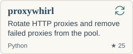</a>

<a href="https://github.com/wyattowalsh/profile-bits">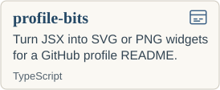</a>
<a href="https://github.com/wyattowalsh/riso">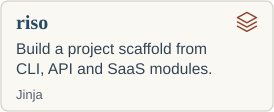</a>
<a href="https://github.com/wyattowalsh/openopps">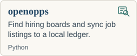</a>
<a href="https://github.com/wyattowalsh/webmedia-dl"></a>
<a href="https://github.com/wyattowalsh/iina-plugin-bookmarks"></a>
<a href="https://github.com/wyattowalsh/nbops">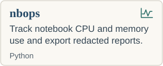</a>
<a href="https://github.com/wyattowalsh/cwa">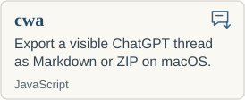</a>
<a href="https://github.com/wyattowalsh/personal-website"></a>
<a href="https://github.com/wyattowalsh/prompts">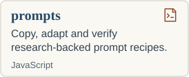</a>
<a href="https://github.com/wyattowalsh/ai-web-feeds"></a>
<a href="https://github.com/wyattowalsh/linkedin-profile-exporter">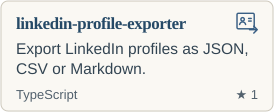</a>

<a href="https://github.com/wyattowalsh/wild-web-wrap-up"></a>
<a href="https://github.com/wyattowalsh/fl-mcp"></a>
<a href="https://github.com/wyattowalsh/mcp-crawl4ai">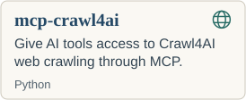</a>
<a href="https://github.com/wyattowalsh/hue-board">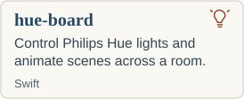</a>
<a href="https://github.com/wyattowalsh/awesome-iina">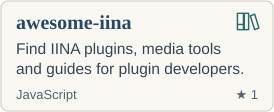</a>
<a href="https://github.com/wyattowalsh/agentic-cad">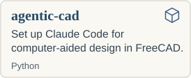</a>
<a href="https://github.com/wyattowalsh/NYC-recs"></a>
<a href="https://github.com/wyattowalsh/iina-plugin-starter"></a>
<a href="https://github.com/wyattowalsh/soundlab"></a>

GitHub repository data as of November 21, 2026.

<!-- README:FEATURED_PROJECTS:END -->

## Metrics

<!-- README:METRICS:START -->
**August 27, 2026** · GitHub, WakaTime and Spotify

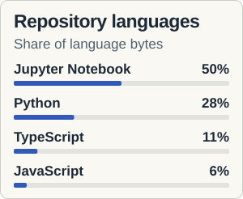
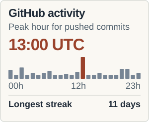
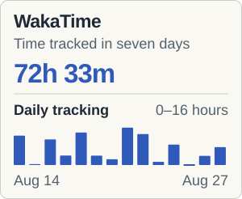
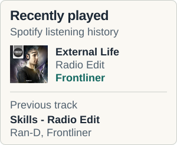

Repository languages · byte shares and creation years

The percentages measure language bytes in non-fork repositories. The full chart groups repositories by creation year and primary language. JetBrains MPS is excluded.

| Language | Rounded share |
| --- | --- |
| Jupyter Notebook | 50% |
| Python | 28% |
| TypeScript | 11% |
| JavaScript | 6% |
| Jinja | 2% |
| HTML | 1% |
| Shell | 1% |
| MDX | 0% (rounded) |

[Language chart by repository creation year](.github/assets/img/metrics-languages.svg)

GitHub activity · push hours, pull requests and streaks

Recent push events are weighted by the number of commits. Activity peaked at **13:00 UTC**. **29%** fell between 23:00 and 05:59 UTC. The contribution streak stood at **1 day**, with a longest streak of **11 days**.

| Repository | Merged pull requests |
| --- | --- |
| riso | 20 |
| ai-web-feeds | 16 |
| proxywhirl | 12 |
| atlas-chat-exporter | 8 |
| iina-plugin-bookmarks | 5 |

Across these five repositories, the Herfindahl concentration index was 24% (100% would put every merge in one repository).

[Full GitHub activity chart](.github/assets/img/metrics-habits.svg)

WakaTime · tracked time, weekly breakdowns and daily totals

This snapshot was generated on August 27, 2026 at 21:21 UTC. WakaTime groups activity in the America/New_York timezone.

| Reporting period | Tracked time |
| --- | --- |
| Last 7 days | 72 hrs 33 mins |
| Last year | 2,193 hrs 33 mins |
| All time | 5,373 hrs 37 mins |

WakaTime reported a daily average of **12 hrs 5 mins** for the seven-day summary. The separate daily series averaged **6 hrs 50 mins** for August 14–27.

| Daily totals | Tracked time |
| --- | --- |
| Aug 14 | 12h 06m |
| Aug 15 | 0h 22m |
| Aug 16 | 10h 33m |
| Aug 17 | 3h 54m |
| Aug 18 | 13h 23m |
| Aug 19 | 3h 51m |
| Aug 20 | 2h 23m |
| Aug 21 | 15h 24m |
| Aug 22 | 12h 45m |
| Aug 23 | 1h 18m |
| Aug 24 | 8h 25m |
| Aug 25 | 0h 00m |
| Aug 26 | 3h 46m |
| Aug 27 | 7h 22m |

| Languages in the seven-day report | Tracked time |
| --- | --- |
| Python | 28 hrs 28 mins |
| JSON | 20 hrs 32 mins |
| Markdown | 11 hrs 48 mins |
| Other | 3 hrs 28 mins |
| TypeScript | 3 hrs 27 mins |
| JavaScript | 1 hr 42 mins |
| Makefile | 45 mins |
| YAML | 39 mins |

| Editors in the seven-day report | Tracked time |
| --- | --- |
| Cursor | 41 hrs 38 mins |
| Codex Vscode | 16 hrs 40 mins |
| Codex CLI | 2 hrs 38 mins |

| Categories in the seven-day report | Tracked time |
| --- | --- |
| AI Coding | 69 hrs 32 mins |
| Browsing | 2 hrs 56 mins |
| Coding | 3 mins |
| Writing Docs | 0 secs |

| Public projects in the seven-day report | Tracked time |
| --- | --- |
| nbadb | 29 hrs 29 mins |
| dotfiles | 5 hrs 12 mins |
| wyattowalsh | 2 hrs 9 mins |
| prompts | 1 hr 58 mins |
| openopps | 1 hr 40 mins |
| personal-website | 1 hr 30 mins |
| signoize | 1 hr 27 mins |

| Platforms | Tracked time |
| --- | --- |
| Mac | 5,366 hrs 37 mins |
| Linux | 5 hrs 51 mins |
| Unknown OS | 1 hr 8 mins |

Each platform uses its longest reported duration across the weekly, yearly and all-time ranges.

| Weekly indicators | Value |
| --- | --- |
| Language diversity (Shannon entropy) | 2.16 bits |
| Share of editor time in the leading editor | 68% |
| Share of category time in Coding or AI Coding | 96% |
| Share of category time in Browsing | 4% |

The GitHub panel accompanying this snapshot recorded 4,767 contributions in 2026 through August 27 and 194 public repositories.

[Full WakaTime chart and annual heatmap](.github/assets/img/wakatime.svg)

Spotify · nine tracks in listening order

The most recent play appears first.

| Track | Artist |
| --- | --- |
| External Life - Radio Edit | Frontliner |
| Skills - Radio Edit | Ran-D, Frontliner |
| If You Find - Radio Edit | Frontliner |
| Whatever! - Radio Edit | Frontliner |
| Ride | Twenty One Pilots |
| Symbols (Q-Base OST 2012) - Origi... | Frontliner |
| HUMBLE. | Kendrick Lamar |
| Deer Dance | System Of A Down |
| Hiding | Dual Damage |

[Spotify listening chart with cover art](.github/assets/img/metrics-music.svg)

<!-- README:METRICS:END -->

<!--START_SECTION:waka-->
<!-- WakaTime SVG is rendered from .github/assets/img/wakatime.svg -->
<!--END_SECTION:waka-->

<!-- README:TECH_STACK:START -->

## My Tech Stack

<!-- SKILLS:START -->

Programming Languages

  
  
  
  
  
  
  
  
  
  
  
  
  
  
  

AI &amp; LLMs

  
  
  
  
  
  
  
  

Data

#### Collection

  
  
  
  
  

#### Storage

  
  
  
  
  
  
  

#### Visualization

  
  
  
  

#### Processing

  
  
  
  
  
  
  
  
  
  
  

#### Modeling

  
  
  
  
  
  
  
  
  

#### Deployment

  
  

Cloud Technologies

  
  
  
  
  

CI/CD Platforms

  
  

Version Control Platforms

  
  
  

Workflow Tools

  
  
  
  
  
  
  
  
  
  
  
  
  
  
  
  
  
  
  

Optimization Tools

  
  
  
  
  
  

Web Development

  
  
  
  
  
  
  
  
  
  
  
  
  
  
  
  
  
  
  
  
  
  
  
  
  
  
  
  

Miscellaneous

  
  
  
  
  
  
  
  
  
  
  
  
  
  
  
  
  
  
  
  
  
  
  
  
  
  
  

<!-- SKILLS:END -->

<!-- README:TECH_STACK:END -->

## Word Clouds

<!-- README:FREQUENCIES:START -->
Most common topics and primary languages among my starred repositories. One repository can have several topics.

<strong><a href=".github/assets/img/wordcloud_typographic_by_topics.svg">Topics</a></strong> · python (774) · ai (656) · llm (540)

<a href=".github/assets/img/wordcloud_typographic_by_topics.svg">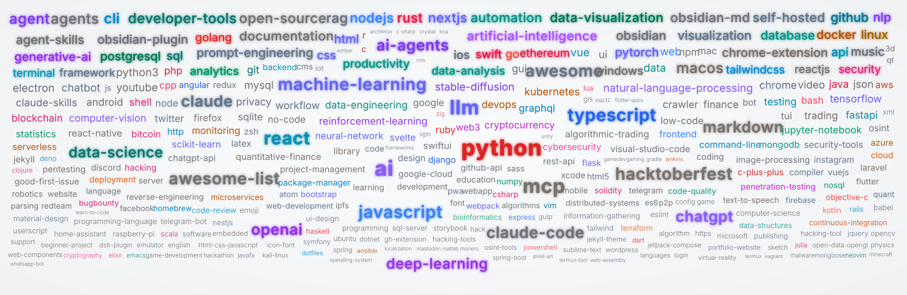</a>

<strong><a href=".github/assets/img/wordcloud_typographic_by_languages.svg">Primary languages</a></strong> · Python (2,269) · TypeScript (1,790) · JavaScript (1,023)

<a href=".github/assets/img/wordcloud_typographic_by_languages.svg">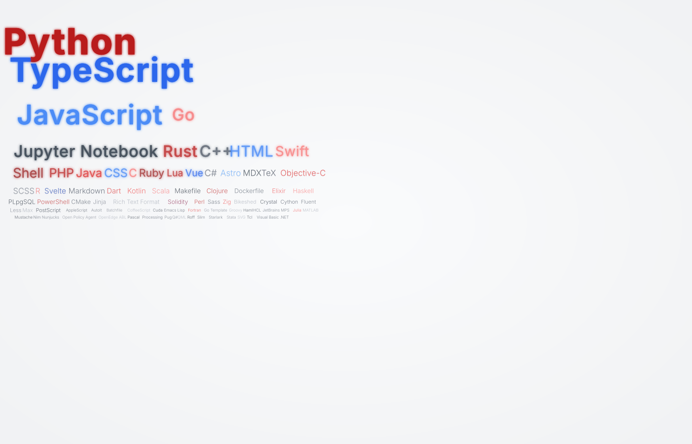</a>

Top 12 topics and languages by starred repository count

**Topics**

| Topic | Starred repos |
| --- | ---: |
| python | 774 |
| ai | 656 |
| llm | 540 |
| mcp | 515 |
| react | 381 |
| typescript | 341 |
| javascript | 329 |
| machine-learning | 309 |
| hacktoberfest | 305 |
| awesome-list | 287 |
| awesome | 279 |
| claude-code | 244 |

**Languages**

| Language | Starred repos |
| --- | ---: |
| Python | 2,269 |
| TypeScript | 1,790 |
| JavaScript | 1,023 |
| Go | 240 |
| Rust | 220 |
| Jupyter Notebook | 219 |
| C++ | 205 |
| HTML | 174 |
| Swift | 134 |
| Shell | 129 |
| PHP | 90 |
| Java | 77 |

<!-- README:FREQUENCIES:END -->

## Latest Blog Posts

<!-- README:BLOG_POSTS:START -->

<a href="https://www.w4w.dev/blog/posts/personal-website">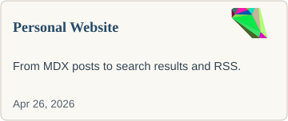</a>
<a href="https://www.w4w.dev/blog/posts/agents">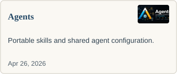</a>
<a href="https://www.w4w.dev/blog/posts/proxywhirl">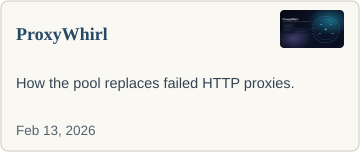</a>
<a href="https://www.w4w.dev/blog/posts/regularized-linear-regression-models-pt3">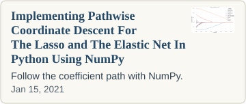</a>
<a href="https://www.w4w.dev/blog/posts/regularized-linear-regression-models-pt2">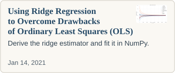</a>

Read the post titles as text

- <a href="https://www.w4w.dev/blog/posts/personal-website">Personal Website</a> · Apr 26, 2026
- <a href="https://www.w4w.dev/blog/posts/agents">Agents</a> · Apr 26, 2026
- <a href="https://www.w4w.dev/blog/posts/proxywhirl">ProxyWhirl</a> · Feb 13, 2026
- <a href="https://www.w4w.dev/blog/posts/regularized-linear-regression-models-pt3">Implementing Pathwise Coordinate Descent For The Lasso and The Elastic Net In Python Using NumPy</a> · Jan 15, 2021
- <a href="https://www.w4w.dev/blog/posts/regularized-linear-regression-models-pt2">Using Ridge Regression to Overcome Drawbacks of Ordinary Least Squares (OLS)</a> · Jan 14, 2021

<a href="https://w4w.dev/feed.xml">Subscribe via RSS</a>
<!-- README:BLOG_POSTS:END -->

## Connect

<!-- README:CONTACT_LINKS:START -->
<a href="https://w4w.dev">w4w.dev</a> · <a href="https://linkedin.com/in/wyattowalsh">LinkedIn</a> · <a href="https://www.kaggle.com/wyattowalsh">Kaggle</a> · <a href="https://x.com/wyattowalsh">X.com</a>
<!-- README:CONTACT_LINKS:END -->

Scan my contact card on another device

<a href=".github/assets/img/qr.png">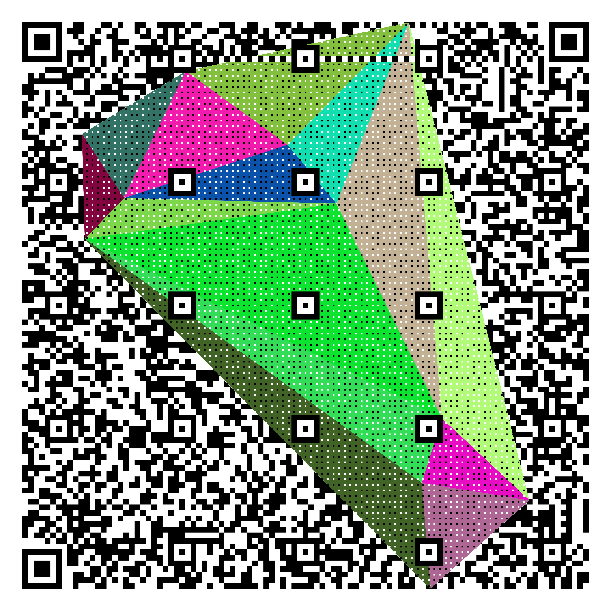</a>

  

  

[Back to top](#wyatt-walsh)
